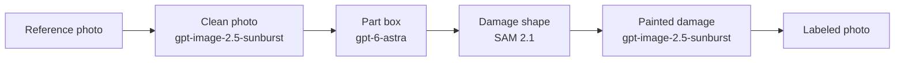

# GPT clean excavator dataset

This branch generates labeled rental-equipment damage photos from one reference photo.
The studio uses GPT clean. SAM 2 runs on the GPU machine.

The GPU host, SSH key, and remote project path stay in the local environment (`STUDIO_SSH_HOST`, `STUDIO_SSH_KEY`, `STUDIO_REMOTE_ROOT`). They are not stored in this repository.

## Workflow

1. **GPT makes the clean photo.** `gpt-image-2.5-sunburst` edits the reference into one undamaged machine, viewpoint, and background.
2. **GPT draws the box.** `gpt-6-astra` returns a pixel box around the part that will be damaged.
3. **SAM 2 makes the shape.** SAM 2.1 cuts that part from the box. The damage shape is drawn inside the part, and that mask is saved as the label.
4. **GPT paints the damage.** `gpt-image-2.5-sunburst` paints inside the mask. Pixels outside the mask stay from the clean photo.

Each result is the clean photo, the mask, and the damaged photo, with the machine, damage, viewpoint, and background recorded beside them.

A one-photo clean-image check from this path is saved at `results/gpt-clean-timing/01_tracked_side_gravel.png`.
