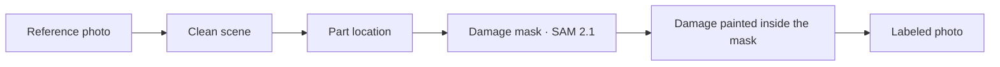

# Agentic FDE

Agentic FDE turns one reference photo and a short inspection request into a labeled damage dataset. The task in this repository is rental return for excavators and haul trucks: body dents, shattered cab glass, flat tires, and bucket damage, across machines, viewpoints, and places.

Each finished item is three files: the clean scene, the damage mask, and the damaged photo. The mask is the label. The machine, damage type, viewpoint, and background are stored with the images.

## What you do

1. Start the studio and open it in a browser.
2. Describe the inspection job, or keep the sample request.
3. Attach a reference photo.
4. Set the image count, machines, damages, viewpoints, and places.
5. Press **Start pipeline**.
6. Read the finished list. Each card shows the clean scene, the mask, and the damaged photo.

Runs are saved under `results/studio/<job-id>/`. `labels.json` is the index for that run.

## How a labeled photo is made



The clean scene is a new undamaged view of the requested machine, viewpoint, and background. A vision model returns a box around the part that will be damaged. SAM 2.1 cuts that part from the box, and a new damage shape is drawn inside the part. Painting changes only the pixels inside the mask. Everything outside the mask stays from the clean scene.

Set `RUN_TARGET=nebius` on the GPU machine to locate the part with NVIDIA Nemotron (`nvidia/Nemotron-3.5-Super-VL`) through Nebius Token Factory. SAM 2.1 still runs on the GPU machine.

Flat tires are made for wheeled machines and trucks. Body dents and shattered glass are made for tracked excavators. A tracked machine does not get a flat tire.

## Setup

Use Python 3.11 or newer. The studio page itself uses the Python standard library. The GPU job needs Pillow, and the GPU machine needs SAM 2.1 Hiera Large available to `shape_on_part.py`.

```bash
python3 -m venv .venv
source .venv/bin/activate
python -m pip install pillow
```

Create a `.env` file in this directory. It is listed in `.gitignore` and must stay on your machine.

```bash
STUDIO_SSH_HOST=user@gpu-host
STUDIO_SSH_KEY=$HOME/.ssh/gpu-key.pem
STUDIO_REMOTE_ROOT=/path/to/this/project/on/the/gpu
STUDIO_PORT=8787
```

| Variable | Meaning |
| --- | --- |
| `STUDIO_SSH_HOST` | SSH destination of the GPU machine, such as `user@host` |
| `STUDIO_SSH_KEY` | Path to the private key on this computer |
| `STUDIO_REMOTE_ROOT` | This project on the GPU machine |
| `STUDIO_PORT` | Local studio port. The default is `8787` |
| `RUN_TARGET` | `nebius` selects NVIDIA Nemotron on Nebius Token Factory for part location |
| `NEBIUS_API_KEY` | Nebius Token Factory key, required when `RUN_TARGET=nebius` |
| `OPENAI_API_KEY` | Key for clean-scene and damage image generation |

Put `OPENAI_API_KEY` and `NEBIUS_API_KEY` in the environment on the GPU machine. Do not commit keys, host addresses, or private key files.

Copy this repository to `STUDIO_REMOTE_ROOT` before the first run. The studio sends the job there over SSH and brings the labeled photos back.

## Run

From this directory, with the virtual environment active:

```bash
python3 studio_server.py
```

Open [http://127.0.0.1:8787](http://127.0.0.1:8787).

The page listens on localhost only. **Start pipeline** sends the request and the reference photo to the GPU machine. **Continue** reattaches to a job that is already running there.

For a first check, press **1 position, 1 background**, keep the image count small, and then press **Start pipeline**.

## Dataset controls

| Control | What it sets |
| --- | --- |
| Total images | Cap for this run, from 1 to 48 |
| Machine varieties | How many of the checked machines are used, taken from the top of the list |
| Camera positions | Named viewpoints |
| Background scenes | Named places |
| Machines | Tracked excavator, wheeled excavator, articulated dump truck, rigid haul truck |
| Damages | Dents, flat tires, shattered windows, bucket or claw dents |

The status line shows the clean-scene count and the labeled-photo count before the run starts.
